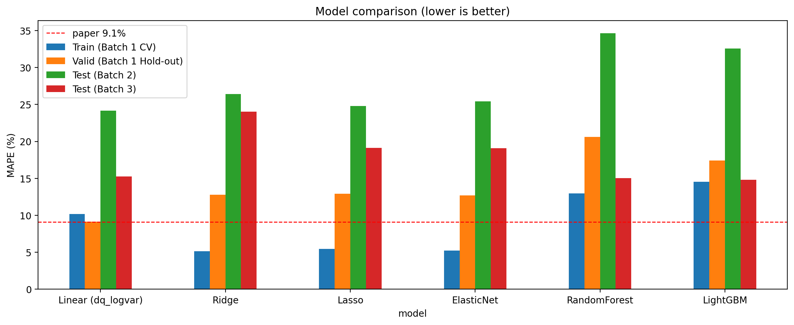
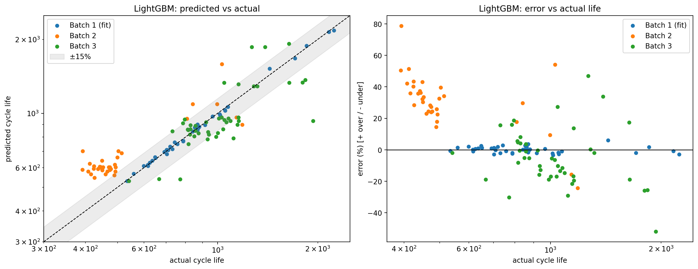
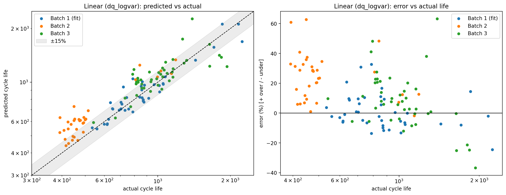

# ESS 배터리 수명 예측

ESS 배터리 교체 비용은 CAPEX의 30~40%를 차지합니다. 이 프로젝트는 **초기 100 사이클 데이터만으로 배터리의 총 수명(cycle life)을 예측**해, 교체 시점을 사전에 계획할 수 있는지 검증합니다.

## 프로젝트 개요

- 데이터셋 : MIT-Stanford Battery Dataset (Severson et al., Nature Energy 2019)
- 학습 데이터 : Batch 1 (2017-05-12)
- 평가 데이터 : Batch 2 (2018-02-20), 추가 평가 Batch 3 (2018-04-12)
- 태스크 : **Regression (Cycle Life 예측)**, Target = log10(cycle_life)
- 최종 모델 : **Linear Regression (dq_logvar 단일 피처)**

## 파일 구조

```
├── data/
│   └── README.md                    # 데이터 출처 및 재현 방법 (원본 미포함)
├── notebooks/
│   └── ess_battery_analysis.ipynb   # 로딩 → EDA → 모델링 실행 결과 (Kaggle)
├── src/
│   ├── preprocess.py                # .mat 로딩, Batch 1·2 병합, EOL 미도달 셀 제거
│   ├── features.py                  # ΔQ(V)·용량·저항·온도·충전 조건 피처 생성
│   └── train.py                     # 분할, 학습, 평가, 오류 분석
├── results/
│   ├── model_performance.csv        # 최종 모델(Linear) 성능 (Reporting format)
│   ├── model_comparison.csv         # 후보 모델 6개 비교
│   ├── predictions.csv              # 셀별 예측값과 오차 (Linear)
│   ├── holdout_stability.csv        # Hold-out 분할 seed별 성능 (Linear)
│   └── figures/
│       ├── model_comparison.png
│       ├── pred_vs_actual_linear.png
│       ├── pred_vs_actual_elasticnet.png
│       └── pred_vs_actual_lightgbm.png
├── requirements.txt
└── README.md
```

## 환경 설정

```bash
git clone https://github.com/<계정명>/ess-battery-project
cd ess-battery-project
pip install -r requirements.txt

# data/README.md 순서대로 데이터 준비 후
python src/preprocess.py --data_dir data/raw --out_dir data/processed
python src/features.py --in_dir data/processed --out data/processed/features.csv
python src/train.py --features data/processed/features.csv --out_dir results
```

---

## EDA

### Cycle Life 분포

- 세 배치 모두 오른쪽 꼬리가 긴 분포 (왜도 +1.2~2.1, 평균 > 중앙값)
- 단수명(500 미만) 비율 : Batch 1 0% / **Batch 2 76%** / Batch 3 0%, 장수명(1,000 초과) 비율 : 24% / 9% / **52%**
- **핵심 발견 : 테스트셋(Batch 2)의 76%가 학습셋(Batch 1) 최솟값(534)보다 짧아, 모델은 학습 범위 밖을 예측해야 한다.**

### 열화 곡선 분석

- 초기 기울기 약 −0.015 mAh/cycle → EOL 직전 약 −0.9~−1.5 mAh/cycle로 **약 45배 가속**
- Knee point는 수명의 약 68~76% 지점에서 발생, 초기 100 사이클 동안 용량 변화는 0.2% 미만
- **핵심 발견 : 초기 용량 "크기"로는 장/단수명을 구분할 수 없고, 다른 신호가 필요하다.**

### ΔQ(V) 곡선 분석

- ΔQ(V) = Q100(V) − Q10(V), 단수명 셀일수록 3.0~3.2V 부근의 골이 깊음
- 단수명 그룹의 ΔQ 분산이 장수명 그룹보다 2~3배 큼, r(log var ΔQ, log 수명) = −0.95 / −0.92 / −0.76
- **핵심 발견 : 용량이 거의 변하지 않은 시점에도 곡선 "모양" 변화가 수명을 강하게 설명하며, 이 관계는 세 배치에서 일관된다.**

### 충전 속도(C-rate)와 수명의 관계

- Batch 1 : 3.6C(80%)-3.6C 평균 2,083 vs 5.4C(80%)-5.4C 평균 546, 고속 그룹 수명 −28%
- Batch 2·3 : r(C1, log 수명) = +0.13 / +0.02, 충전 시간과의 상관은 배치마다 부호가 뒤집힘
- 동일 프로토콜 내에서도 수명 편차 7~17%
- **핵심 발견 : 충전 조건만으로는 수명을 설명할 수 없으며, 같은 프로토콜 셀이 train/valid에 섞이면 누수가 생긴다.**

### 상관관계 및 다중공선성 (추가 확인)

- 세 배치 모두에서 부호가 같고 강한 피처는 ΔQ 계열(dq_logvar, dq_logmin, dq_mean)뿐
- VIF : dq_logvar 469, dq_logmin 416 등 다중공선성 심각

---

## Modeling

### 피처 엔지니어링 전략

| 구분        | 피처                         | 근거                                      |
| ----------- | ---------------------------- | ----------------------------------------- |
| 핵심        | dq_logvar                    | 세 배치 공통으로 강한 음의 상관           |
| 후보        | dq_logmin, dq_mean, dq_kurt  | 배치 간 부호 일관, 공선성은 정규화로 처리 |
| 보조        | qd_2, qd_max_minus_2         | 원논문 사용 용량 피처                     |
| 제외        | C1, 충전 시간, 온도, IR 계열 | 배치마다 상관 부호가 뒤집힘               |
| 제외 (누수) | knee point, 후기 기울기      | EOL까지의 미래 데이터 필요                |

### 검증 설계

- Batch 1을 **충전 프로토콜 단위로** Train / Hold-out(20%) 분리 → 같은 프로토콜 셀이 양쪽에 섞이지 않음
- Train 내부는 프로토콜 그룹 기준 GroupKFold(5)로 하이퍼파라미터 탐색
- 선택된 하이퍼파라미터로 Batch 1 전체 재학습 후 Batch 2·3 평가
- MAPE는 log 예측값을 원 단위(cycle)로 되돌려 계산

### 후보 모델 비교

| 모델                        | Train (CV) | Valid (Hold-out) | Test (Batch 2) | Test (Batch 3) |
| --------------------------- | ---------- | ---------------- | -------------- | -------------- |
| **Linear (dq_logvar 단일)** | 10.17      | 9.15             | **24.18**      | 15.26          |
| Ridge                       | 5.15       | 12.81            | 26.40          | 24.04          |
| Lasso                       | 5.46       | 12.94            | 24.77          | 19.14          |
| Elastic Net                 | 5.22       | 12.71            | 25.41          | 19.09          |
| Random Forest               | 12.96      | 20.60            | 34.62          | 15.02          |
| LightGBM                    | 14.53      | 17.41            | 32.59          | **14.82**      |



- **트리 모델의 외삽 한계 확인** : RF·LightGBM은 Batch 2에서 33~35%로 가장 나빴다. 학습셋 최단 수명(534)보다 짧은 값을 예측하지 못해, 실제 400~500 사이클 셀들을 550~650으로 일정하게 예측했다. EDA에서 세운 가설이 그대로 확인되었다.
- **Elastic Net의 선택** : 6개 피처 중 dq_logvar(표준화 계수 −0.15) 외에는 계수가 0.02 이하로, 사실상 dq_logvar 하나만 사용했다.



### 모델 선택 및 근거

- 후보 모델 : Linear (dq_logvar 단일, 베이스라인), Ridge, Lasso, Elastic Net, Random Forest, LightGBM
- 최종 모델 : **Linear (dq_logvar 단일)**
- 선택 이유 : 처음에는 원논문과 같은 Elastic Net을 메인 모델로 계획했지만, 결과를 보고 단순 선형 모델을 최종 모델로 선택했다.
  - Batch 2(24.2% vs 25.4%)와 Batch 3(15.3% vs 19.1%) 모두에서 Elastic Net보다 오차가 작았다.
  - Elastic Net도 6개 단서 중 dq_logvar 외 5개의 계수를 거의 0으로 줄여, 사실상 같은 결론에 도달했다. 나머지 5개 단서는 Batch 1 안에서는 성능을 높였지만, 다른 배치에서는 도움이 되지 않았다.
  - Train(10.17%)과 Valid(9.15%)의 차이가 작아 과적합 위험이 낮고, 단서 하나로 예측 근거를 설명할 수 있다.
  - 원논문의 Variance model(ΔQ 분산 단일 피처)과 같은 구조로, 배치가 바뀌는 환경에서는 가장 단순한 모델이 가장 안정적이었다.

**단서의 양보다 질**

단서는 양보다 질이 중요했다. 6개 단서를 모두 쓴 모델보다 dq_logvar 하나만 쓴 모델이 Batch 2(24.2% vs 25.4%)와 Batch 3(15.3% vs 19.1%) 모두에서 더 정확했다. dq_logvar는 세 배치 모두에서 수명과 일관된 관계를 보인 반면, 나머지 단서들은 Batch 1에서만 통하는 정보였기 때문이다. 다른 환경에서도 유지되는 핵심 단서 하나가, 한 환경에서만 통하는 단서 여러 개보다 더 큰 효과를 냈다.

### 성능 결과 (최종 모델 : Linear dq_logvar)

| 구분                       | MAPE (%) | 비고                             |
| -------------------------- | -------- | -------------------------------- |
| Train (Batch 1 CV)         | 10.17    | 프로토콜 그룹 GroupKFold(5) 평균 |
| Valid (Batch 1 Hold-out)   | 9.15     | 프로토콜 단위 20% 분리           |
| Test (Batch 2)             | 24.18    | Batch 1 전체 재학습 후 평가      |
| Gap (Train-Valid)          | −1.02    | (+) : 과적합 의심                |
| Gap (Valid-Test)           | 15.03    | (+) : 배치간 일반화 저하 의심    |
| Gap (Target-Test)          | 15.08    | Target : 원논문 9.1%             |
| Test (Batch 3)             | 15.26    |                                  |
| Gap (Batch2-Batch3)        | −8.92    | Test 성능 간 비교                |
| Gap (Target-Test, Batch 3) | 6.16     | Batch 3 기준, 원논문 성능 비교   |

> MAPE는 낮을수록 좋은 지표이므로 Gap = 후단계 오차 − 전단계 오차로 계산했습니다. (+)는 성능 저하를 의미합니다.

**Hold-out 안정성 (분할 seed 20회 반복)**
| 모델 | Train (CV) 평균 | Valid 평균 (범위) | Test Batch 2 (범위) | Test Batch 3 (범위) |
| --- | --- | --- | --- | --- |
| Linear (최종) | 9.32 | 10.15 (6.27 ~ 14.71) | 24.18 (고정) | 15.26 (고정) |
| Elastic Net | 7.44 | 8.86 (4.18 ~ 13.80) | 33.38 (25.41 ~ 39.66) | 17.07 (13.58 ~ 20.66) |

- Hold-out이 셀 9개 안팎이라 분할에 따라 Valid가 크게 흔들린다. 소규모 데이터에서는 한 번의 분할 결과만으로 과적합 여부를 판단하기 어렵다.
- Elastic Net은 분할마다 선택되는 하이퍼파라미터가 달라져 Batch 2 성능이 25.4~39.7%로 흔들렸다. Linear는 조정할 하이퍼파라미터가 없어 테스트 성능이 고정되며, Train과 Valid 차이도 작아 가장 안정적이다.

### 원논문과의 비교

처음에는 논문보다 오차가 약 3배 큰 결과를 보고 모델이 잘못됐다고 생각했다. 하지만 분석해 보니 비교의 잣대 자체가 달랐다. 원논문은 Batch 1과 2를 섞어 같은 환경의 셀끼리 예측한 반면, 이번 과제는 Batch 1만으로 다른 시기·다른 조건의 Batch 2를 예측했다. 환경이 다른 데이터를 같은 기준으로 맞히는 것은 처음부터 더 어려운 문제였다.

이를 확인하기 위해 원논문처럼 Batch 1과 2를 합친 뒤 셀을 번갈아 학습(38셀)과 테스트(37셀)로 나눠 다시 평가했다.

| 평가 방식                          | Linear (dq_logvar) | Elastic Net |
| ---------------------------------- | ------------------ | ----------- |
| 이번 과제 방식 (Batch 1 → Batch 2) | 24.18%             | 25.41%      |
| 원논문 방식 (Batch 1·2 혼합 분할)  | 13.59%             | **10.30%**  |
| 원논문 방식 학습 → Batch 3         | **13.30%**         | 18.37%      |

- 같은 Elastic Net이 평가 방식만 바꿨을 때 25.41%에서 10.30%로 줄어 원논문(9.1%)과 비슷한 수준이 되었다. 원논문과의 성능 차이는 대부분 모델이 아니라 평가 방식의 차이에서 왔다.
- 같은 환경 안에서는 단서 6개를 쓴 Elastic Net(10.30%)이 Linear(13.59%)보다 정확했지만, 처음 보는 Batch 3에서는 Linear(13.30%)가 Elastic Net(18.37%)보다 정확했다. 추가 단서들은 같은 환경에서는 도움이 되지만, 환경이 바뀌면 오히려 오차를 키운다.
- 따라서 실제 현장처럼 새로운 배치의 배터리를 예측해야 하는 상황에서는, 논문의 수치보다 배치 단위로 평가한 성능을 기준으로 삼아야 하며, 단순한 모델이 더 안전한 선택이다.

### 오류 분석 (최종 모델 : Linear dq_logvar)



- 모델이 가장 크게 틀린 셀의 공통점 :
  - Batch 2는 평균 +24.1%, 중앙값 +25.6%로 거의 모든 셀을 일관되게 길게 예측했다. Elastic Net에서도 같은 경향(+24.7%)이 나타나, 모델이 아닌 배치 자체의 차이로 판단된다.
  - Batch 2에서 학습 범위 밖(Batch 1 최단 수명 534 미만) 셀 28개의 평균 오차가 25.4%로, 범위 안 셀 6개(18.3%)보다 컸다. 오차 상위 10개 중 4개가 실제 수명 393~452의 짧은 셀이다. (예: b2c6 실제 393 → 예측 632, b2c18 실제 449 → 예측 730)
  - 나머지 6개는 Batch 1에 없던 `newstructure` 프로토콜 셀이다. (예: b3c37 실제 1,390 → 예측 2,269, b2c44 실제 841 → 예측 1,248)
  - Elastic Net 대비 극단적 오차가 크게 줄었다. b3c37의 오차는 +170%에서 +63%로 감소했고, Batch 3 편향도 평균 +13.9%에서 +8.1%로 줄었다.
- 원인 가설 및 개선 방향 :
  - 배치(실험 시기·조건)가 바뀌면 같은 ΔQ 값에 대응하는 수명 자체가 달라진다.
  - 오차가 한 방향으로 일관되므로, 새 배치의 소수 셀 실제 수명으로 예측값을 보정하면 오차를 줄일 수 있다.
  - 학습 범위 밖 입력에 대해서는 예측값을 그대로 쓰지 않고 경고를 함께 제공해야 한다.

---

## ESS 도메인 해석

다른 배치에서 학습한 모델을 새 배치에 그대로 적용해 교체 시점을 정하는 것은 신뢰하기 어렵다. 학습하지 않은 환경의 배터리를 맞힐 수 있다고 믿는 것 자체가 위험한 가정이다.

다만 실제 운영 환경과 같은 조건의 데이터를 계속 모아 모델을 업데이트한다면 활용할 수 있다고 본다. 이번 분석에서 가장 크게 틀린 셀은 학습 데이터에 없던 실험 조건(newstructure)의 셀이었다. 즉 모델의 한계는 알고리즘보다 "학습한 환경과 적용할 환경의 차이"에서 왔다. 따라서 현장 배터리의 데이터를 꾸준히 수집해 같은 환경에서 다시 학습하고, 새로운 조건의 배터리가 들어오면 데이터가 충분히 쌓이기 전까지는 예측값을 보수적으로 해석해야 한다.

## 참고문헌

- Severson et al. (2019). Data-driven prediction of battery cycle life before capacity degradation. Nature Energy, 4, 383–391.
